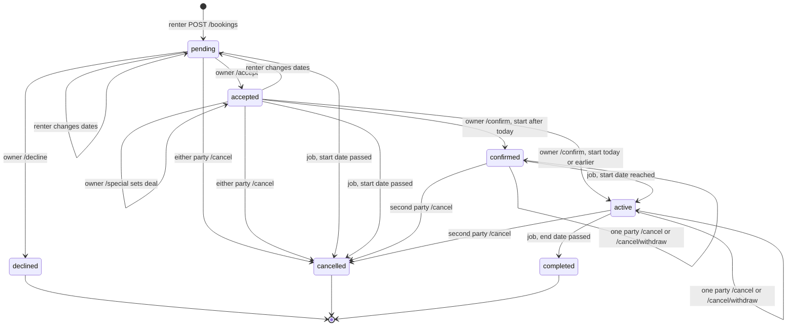

# API Endpoint Documentation — Summer Storage Marketplace

**Base URL:** `/api`
**Auth scheme:** `Authorization: Bearer <access_token>` (opaque UUID access token, 15 min TTL)
**Content type:** `application/json` unless a `multipart/form-data` upload is noted.
**Interactive docs:** FastAPI Swagger at `/docs` — test every route here before wiring the frontend.

This document lists endpoints in **the order you should implement them** (from `notes.md`
build order). Each phase builds on the previous one, so complete and test a phase in
Swagger before moving on.

---

## Conventions

### Standard error envelope
All errors return this shape (implement once in `utils/exception_handler.py` and register it
in `main.py`):

```json
{
  "detail": "Human-readable message",
  "code": "Error Code"
}
```

### Common status codes
| Code | Meaning |
|---|---|
| `200 OK` | Successful read/update |
| `201 Created` | Resource created |
| `204 No Content` | Successful delete, no body |
| `400 Bad Request` | Validation/business-rule failure |
| `401 Unauthorized` | Missing/invalid/expired access token |
| `403 Forbidden` | Authenticated but not allowed (e.g. not the owner) |
| `404 Not Found` | Resource does not exist |
| `409 Conflict` | State conflict (e.g. double-booking, duplicate email) |
| `422 Unprocessable Entity` | FastAPI/Pydantic schema validation error |

### Auth column legend
- **Auth: none** — public, no token required.
- **Auth: required** — valid access token required (`get_current_user` dependency).
- **Auth: owner** — valid token *and* the caller must own the resource.

> **Spec note — token type.** The PRD (§6.1) specifies **opaque UUID access tokens + Redis
> refresh tokens**, while `ProjectArchitecture.md` says "JWT". This doc follows the PRD (UUID
> tokens stored/blacklisted in Redis). Pick one and keep `routers/deps.py` consistent with it.

---

# Phase 1 — MVP

## 1. Auth  (`/api/auth`)

Implement first: nothing else can be protected until this exists. Router file:
`backend/routers/auth.py`.

### 1.1 `POST /auth/register`
Create a new account.

- **Auth:** none
- **Request**
```json
{
  "email": "student@university.edu",
  "password": "min-8-chars",
  "username": "Jane Doe"
}
```
- **Response `201`** — the created user profile (see `UserResponse` in §2).
- **Logic**
  - Validate email format (`EmailStr`) and password length.
  - Reject if email already exists → `409 EMAIL_TAKEN`.
  - Hash password with **bcrypt (cost ≥ 12)**, insert into `users`.
  - `is_verified` starts `false`.
- **Errors:** `409` duplicate email, `422` bad payload.

### 1.2 `POST /auth/login`
Authenticate and issue tokens.

- **Auth:** none
- **Request**
```json
{ "email": "student@university.edu", "password": "..." }
```
- **Response `200`**
```json
{
  "access_token": "uuid-string",
  "refresh_token": "uuid-string",
  "token_type": "bearer",
  "expires_in": 900
}
```
- **Logic**
  - Look up user by email; verify bcrypt hash.
  - Generate UUID access token (15 min) and refresh token (7 days).
  - Store `session:{user_id}` → refresh token in Redis (TTL 7 days).
- **Errors:** `401 INVALID_CREDENTIALS`.
- **Phase 2:** rate-limit to 5 attempts / 60s per IP (`rate:{ip}:login`).

### 1.3 `POST /auth/refresh`
Exchange a valid refresh token for a new access token.

- **Auth:** none (refresh token in body)
- **Request**
```json
{ "refresh_token": "uuid-string" }
```
- **Response `200`** — same shape as login.
- **Logic:** validate refresh token against `session:{user_id}` in Redis; issue a new access
  token. Rotate the refresh token if desired.
- **Errors:** `401 INVALID_REFRESH_TOKEN` (expired/unknown).

### 1.4 `POST /auth/logout`
Invalidate the current access token.

- **Auth:** required
- **Request:** empty body (token from `Authorization` header).
- **Response `204`**
- **Logic:** add token to `blacklist:{token}` in Redis (TTL = remaining token TTL); delete
  `session:{user_id}`.

### 1.5 `POST /auth/logout-all`
Log the user out of every device.

- **Auth:** required
- **Request:** empty body.
- **Response `200`** — `"Logged out of all devices"`
- **Logic:** every token issued to the user is tracked in the Redis set `user_sessions:{user_id}`;
  all `token:{token}` keys in the set and the set itself are deleted. `POST /auth/reset-password`
  does the same.

> **Phase 2 — Google Login.** PRD lists Google OAuth. Add `POST /auth/google` (exchange Google
> ID token → platform tokens) when you get there; not required for MVP.

---

## 2. User Profile  (`/api/users`)

Router file: `backend/routers/users.py` (already scaffolded).

### Shared schema — `UserResponse`
```json
{
  "id": "uuid",
  "email": "student@university.edu",
  "username": "Jane Doe",
  "phone": "+1...",
  "university": "State U",
  "description": "Junior with a dry basement closet two blocks from campus.",
  "is_verified": true,
  "avatar_url": "https://seaweedfs/.../avatar.jpg"
}
```

### 2.1 `GET /users/me`
Get the authenticated user's full profile.

- **Auth:** required
- **Response `200`:** `UserResponse`
- **Errors:** `401`.

### 2.2 `PUT /users/me`
Update editable fields.

- **Auth:** required
- **Request** (all optional)
```json
{ "username": "New Name", "phone": "+1...", "university": "State U", "description": "..." }
```
- **Response `200`:** updated `UserResponse`.
- **Logic:** email is **not** editable here (needs separate verification flow). `description`
  is optional, max **200 words**. Update `updated_at`.

### 2.3 `POST /users/me/avatar`
Upload/replace avatar.

- **Auth:** required
- **Request:** `multipart/form-data` with `file` (image, ≤ 10 MB).
- **Response `200`:** updated `UserResponse` with new `avatar_url`.
- **Logic:** upload to SeaweedFS, save returned URL to `users.avatar_url`, delete old object.
- **Errors:** `400 FILE_TOO_LARGE` / `UNSUPPORTED_MEDIA_TYPE`.

### 2.4 `GET /users/{id}`
Public profile of any user.

- **Auth:** none
- **Response `200`:** public subset of `UserResponse` (omit `email`/`phone` if you want them
  private — recommended). Used on listing pages to show lister info.
- **Errors:** `404 USER_NOT_FOUND`.

---

## 3. Spaces  (`/api/spaces`)

The core listing CRUD + search + images. Router file: `backend/routers/spaces.py`.

> **Spec note — space `type`.** DB index `idx_spaces_city_type` references a `type` column and
> the code uses `Literal["room","apartment","storage"]`, but the `spaces` table in
> `DatabaseSchema.md` has no `type` column and the PRD defines types as
> **`closet | shelf | garage | basement | room`**. **Action:** add a `type` column
> (Postgres enum or text) to `spaces` and use the PRD value set. This doc uses the PRD set.
>
> **Spec note — price.** DB defines `price` + `price_type` enum
> (`single | recurring_per_month | recurring_per_week`). Prefer these over the code's
> `price_per_month`. Fields below follow the DB schema.

### Shared schema — `SpaceResponse`
```json
{
  "id": 1,
  "owner_id": "uuid",
  "type": "garage",
  "title": "Dry garage corner near campus",
  "description": "...",
  "city": "Springfield",
  "state": "IL",
  "postal_code": "12345",
  "approx_location": { "lat": 40.12, "lng": -74.5 },
  "price": 60.00,
  "price_type": "recurring_per_month",
  "available_from": "2026-06-01",
  "available_to": "2026-08-15",
  "is_active": true,
  "not_accepting": false,
  "expired_at": "2026-07-22T00:00:00Z",
  "view_count": 142,
  "is_saved": false,
  "images": ["https://seaweedfs/.../1.jpg"],
  "avg_rating": 4.6
}
```
> **Privacy:** never return exact `address`, `latitude`, or `longitude` to non-confirmed
> renters. Return only `city`, `state`, `postal_code`, and a **fuzzed** `approx_location` (snapped to
> the block, computed on the fly). Exact address is revealed only after a booking is confirmed.
>
> **Implementation status:** fuzzing is not built yet. For now `latitude` and `longitude` are
> returned as stored on the full listing (`GET /spaces/{id}`, `/me`, `/post`, `PUT`) and on
> every list item (`GET /spaces/all`, `/me`, `/from/{owner_id}`, saved, history) so the map can
> place pins. The listing detail page also shows an exact pin at those coordinates (it used to
> show an approximate circle). Apply the fuzzing above before real launch.

### 3.1 `POST /spaces/post`
Create a listing.

- **Auth:** required
- **Request — `SpaceRequest`**
```json
{
  "type": "garage",
  "title": "Dry garage corner near campus",
  "description": "6ft x 4ft, dry, self-serve access M-F 9-6",
  "address": "123 Main St",
  "city": "Springfield",
  "state": "IL",
  "postal_code": "12345",
  "price": 60.00,
  "price_type": "recurring_per_month",
  "available_from": "2026-06-01",
  "available_to": "2026-08-15"
}
```
- **Response `201`:** `SpaceResponse` (`owner_id` = caller).
- **Logic**
  - Geocode `address` via **OpenStreetMap Nominatim** (base URL from the `GEOCODER_URL` env var, so it
    can be switched to a Nominatim-compatible provider such as LocationIQ; `GET {GEOCODER_URL}/search`
    with `street`, `city`, `state`, `postalcode`, `countrycodes`, `format=jsonv2`, `limit=1`, plus
    `key` when `GEOCODER_API_KEY` is set and the provider is not the public Nominatim server) → store `latitude`/`longitude`. Empty result →
    `400 GEOCODE_FAILED`.
  - Coordinates sent by the client (`latitude` and `longitude` together) are kept as-is and skip
    geocoding. Results are cached in Redis (30 days for matches, 1 hour for misses) and requests
    to the geocoder are limited to about one per second.
  - If the geocoder is unreachable, the listing is still saved, without coordinates (it does not
    appear on the map until `PUT /spaces/{id}` or `python -m scripts.backfill_geocodes` fills them in).
  - `PUT /spaces/{id}` geocodes again only when `address`, `city`, `state` or `postal_code`
    changed, or when the listing has no coordinates yet.
  - `is_active` = true; set `expired_at` = now + 1 month (auto-hidden after, renewable; auto
    delete at 3 months).
- **Errors:** `400 GEOCODE_FAILED`, `422` validation (e.g. `available_to < available_from`).

### 3.2 `GET /spaces/all`
Search/list with filters. **Cached in Redis.**

- **Auth:** none
- **Query params**
  | Param | Type | Notes |
  |---|---|---|
  | `city` | string | exact/indexed match |
  | `state` | string (max 2) | two-letter state code, case-insensitive exact match (e.g. `il`) |
  | `type` | enum | space type filter |
  | `available_from` | date | overlap with listing window |
  | `available_to` | date | overlap with listing window |
  | `min_price` | float | |
  | `max_price` | float | |
  | `price_type` | enum | |
  | `page` | int | default 1 |
  | `page_size` | int | default 20, cap 100 |
  | `show_non_accepting` | bool | default `false`; `true` also returns spaces with `not_accepting = true` |
  | `south`, `north`, `west`, `east` | float | visible map area in degrees; all four or none. `south < north`, `west < east` |
- **Response `200`**
```json
{ "results": [ /* SpaceInfoResponse[] */ ], "total": 137, "page": 1, "page_size": 20 }
```
- **Logic**
  - Only return `is_active = true` AND `expired_at > now()`.
  - Also require `not_accepting = false` unless `show_non_accepting=true`. The flag is part of
    the cache key, so the two variants are cached separately.
  - With a map area, only listings whose `latitude`/`longitude` fall inside it (listings without
    coordinates are left out). The area is first grown outward to a grid about 1/8 of its size, so
    small pans of the map give the same bounds and share one cache entry.
  - Sort by **relevance (date-match quality) then price**.
  - Cache: hash the normalized query → `search:{hash}` (TTL 5 min). Invalidate on any listing
    create/update/delete.
- **Errors:** `400` invalid filters, including partial or inverted map bounds.

### 3.2a `GET /spaces/pins`
Map pins for every listing in a city-sized area. Takes the same query params as `/spaces/all`
(paging is ignored) and shares its cache.

- **Auth:** none
- **Query params:** `south`, `north`, `west`, `east` are required. The larger side of the area may be
  at most **0.5°** (about 55 km).
- **Response `200`**
```json
{ "pins": [ { "id": 12, "title": "Dry garage corner", "latitude": 34.414, "longitude": -119.8489,
             "price": 50.0, "price_type": "single" } ],
  "total_count": 1, "truncated": false }
```
- **Logic**
  - Returns at most **300** pins, newest first by default. `truncated` is `true` when more matched;
    `total_count` counts matches up to 500.
- **Errors:** `400 BOUNDS_REQUIRED`, `400 AREA_TOO_LARGE`, `400` invalid filters.

### 3.3 `GET /spaces/{id}`
Listing detail. **Cached in Redis.**

- **Auth:** none
- **Response `200`:** `SpaceResponse` (+ `images`, `avg_rating`; optionally owner summary).
- **Logic:** read-through cache `space:{id}` (TTL 10 min). Still fuzz location. If the
  caller is authenticated, record the view via the same write path as `POST /history/{space_id}`
  (§5.1) so `view_history` and `spaces.view_count` stay in sync. If this GET is served
  entirely from cache, the client should still call `POST /history/{space_id}`. Optionally
  include `is_saved` when a token is present (§4.4).
- **Errors:** `404 SPACE_NOT_FOUND`.

### 3.4 `PUT /spaces/{id}`
Update a listing.

- **Auth:** owner
- **Request:** `SpaceRequest` (full or partial — pick one and be consistent).
- **Response `200`:** updated `SpaceResponse`.
- **Logic:** verify `owner_id == caller` → else `403`. Re-geocode if address changed.
  **Invalidate** `space:{id}` and any `search:*` caches.
- **Errors:** `403 NOT_OWNER`, `404`.

### 3.5 `DELETE /spaces/{id}`
Remove a listing.

- **Auth:** owner
- **Response `204`**
- **Logic:** verify ownership; delete (or soft-delete via `is_active=false`). Cascade-delete
  `space_images`. Invalidate caches.
- **Errors:** `403`, `404`.

### 3.6 `POST /spaces/{id}/images`
Upload photos (up to 10 per listing).

- **Auth:** owner
- **Request:** `multipart/form-data` with `files` (1..N images, ≤ 10 MB each).
- **Response `201`**
```json
{ "images": ["https://seaweedfs/.../1.jpg", "..."] }
```
- **Logic:** verify ownership; upload each original to SeaweedFS and a 400px long-edge thumbnail named `{orig_photo_uuid}-thumb.ext` in the same folder. Insert one `space_images` row per original (`url` only) with incrementing `sort_order`. List cards derive `thumbnail_url` by inserting `-thumb` before the extension. Enforce the 10-image cap → `400 IMAGE_LIMIT_REACHED`.
- **Errors:** `400`, `403`, `404`.

### 3.7 `GET /spaces/me`
The caller's own listings, for managing them.

- **Auth:** required
- **Query params:** `page` (default 1), `page_size` (default 25, cap 100)
- **Response `200`:** `SpaceListReducedResponse`
```json
{
  "total_count": 3, "has_more": true, "total_pages": 2,
  "spaces": [{
    "id": 1, "title": "...", "city": "Springfield", "state": "IL",
    "latitude": 39.7817, "longitude": -89.6501, "price": 60.00,
    "price_type": "recurring_per_month", "thumbnail_url": "https://seaweedfs/.../1-thumb.jpg",
    "available_from": "2026-06-01", "available_to": "2026-08-15",
    "is_active": true, "not_accepting": false, "expired_at": "2026-07-22T00:00:00Z",
    "view_count": 142, "updated_at": "2026-06-22T00:00:00Z"
  }]
}
```
- **Logic:** includes hidden (`is_active = false`) and expired listings so the owner can see
  what to renew; `is_active` and `expired_at` say which is which. Most recently updated first.

### 3.8 `GET /spaces/from/{owner_id}`
One owner's public listings.

- **Auth:** none
- **Query params:** `page` (default 1), `page_size` (default 25, cap 100)
- **Response `200`:** `SpaceListReducedResponse` (same item shape as §3.7)
- **Logic:** only `is_active = true` AND `expired_at > now()`; `total_count` and `total_pages`
  count only those. The owner's id list is cached and cleared whenever one of their listings
  is created, updated, hidden, re-activated, or renewed. Spaces with `not_accepting = true` are
  still listed, carrying the flag.
- **Errors:** `400` invalid UUID.

### 3.9 `PATCH /spaces/{id}/accepting`
Stop or resume taking new booking requests. The listing stays visible.

- **Auth:** owner
- **Request Body**

```json
{ "not_accepting": true }
```

- **Response `200`:** the updated `SpaceResponse`.
- **Logic:** sets `spaces.not_accepting` and clears the listing's detail cache and the owner's
  list cache. While it is `true`, `POST /bookings` for this space returns `400`, and search hides
  the space unless `show_non_accepting=true`. Requests made before the flag was set can still be
  accepted or declined.
- **Errors:** `400` invalid body, `403` not the owner (also returned for an unknown space, like
  `PUT /spaces/{id}`).

### 3.10 `GET /map/geocode`
Preview where an address lands on the map, for example before the listing form is submitted.
Router file: `backend/routers/map.py` (mounted at `/api/map`).

- **Auth:** required
- **Query params:** `address` (required), `city` (required), `state`, `postal_code`
- **Response `200`**
```json
{ "code": 200, "message": "Location found", "data": { "latitude": 39.7817, "longitude": -89.6501 } }
```
- **Logic:** same geocoder, cache, and rate limit as §3.1. Not meant for search-as-you-type: public
  Nominatim forbids autocomplete.
- **Errors:** `400 GEOCODE_FAILED` (no match, or invalid query), `401`, `503 GEOCODER_UNAVAILABLE`.

### 3.11 `GET /map/autocomplete`
Street-address suggestions while the user types in the listing form.

- **Auth:** required
- **Query params:** `text` (required, 3–255 characters)
- **Response `200`:** up to 5 suggestions, best match first. Each carries what the form fields need,
  including coordinates, so a listing created from a suggestion can send them as `latitude` and
  `longitude` and skip geocoding (§3.1).
```json
{
  "code": 200,
  "message": "Suggestions found",
  "data": {
    "suggestions": [
      {
        "label": "6689 El Colegio Road, Isla Vista, CA 93117",
        "address": "6689 El Colegio Road",
        "city": "Isla Vista",
        "state": "CA",
        "postal_code": "93117",
        "latitude": 34.417199,
        "longitude": -119.861931
      }
    ]
  }
}
```
- **Logic:** calls Geoapify's autocomplete API (`AUTOCOMPLETE_URL`) with `AUTOCOMPLETE_API_KEY`, limited
  to `MAP_COUNTRY_CODES`. Results that are not street addresses (no street or city) and duplicates
  are dropped. Results are cached in Redis for a day. Public Nominatim cannot be used for this.
- **Errors:** `400` invalid query, `401`, `503 GEOCODER_UNAVAILABLE` (no `AUTOCOMPLETE_API_KEY`
  configured, or the provider failed). The frontend treats any error as "no suggestions".

> **Phase 2 — Map view.** `GET /spaces/map?bbox=w,s,e,n&<filters>` returns GeoJSON of listings
> within the bounding box + a true total count, capped at ~200–300 markers with fuzzed
> coordinates. Cache under a rounded-bounds key (short TTL). Ships with the Zillow-style map
> ("Search this area" button); not required for MVP list view.
>
> **Saved / views.** When the caller is authenticated, include `is_saved` on `SpaceResponse`
> (and on each card in `GET /spaces/all`) via an `EXISTS` on `saved_spaces` — see §4.4.
> Recording a view is §5 (`POST /history/{space_id}`), not a field on this router.

---

## 4. Saved Spaces  (`/api/saved`)

Watchlist / heart-toggle. Router file: `backend/routers/saved_space.py`.
This is a **user collection**, not listing CRUD — do not put these on `/api/spaces`.

Table: `saved_spaces` (composite PK `(user_id, space_id)`). There is no `saved_count` on
`spaces` — totals are `COUNT(*)` on this table.

### Shared schema — `SavedSpaceItem`
A listing card plus when the caller saved it. Reuse the public `SpaceResponse` fields from §3
(fuzzed location; omit exact address).

```json
{
  "space": { /* SpaceResponse */ },
  "saved_at": "2026-07-22T10:00:00Z"
}
```

### 4.1 `GET /saved/list`
The caller's saved list, newest first.

- **Auth:** required
- **Query**
  | Param | Type | Notes |
  |---|---|---|
  | `page` | int | default 1 |
  | `page_size` | int | default 25, cap 100 |
- **Response `200`**
```json
{
  "results": [ /* SavedSpaceItem[] */ ],
  "total": 12,
  "page": 1,
  "page_size": 25
}
```
- **Logic:** `saved_spaces` for `user_id = caller`, join `spaces`, order by
  `saved_spaces.created_at DESC`. Skip inactive/expired listings or include them with
  `is_active: false` so the UI can show "no longer available" — pick one and stay consistent.
- **Errors:** `401`.

### 4.2 `POST /saved/{space_id}`
Save (favorite) a listing. Idempotent.

- **Auth:** required
- **Response `201`:** `SavedSpaceItem` if a new row was inserted; **`200`** if it was already
  saved (same body). Either is fine as long as the client treats both as "now saved".
- **Logic**
  - `404 SPACE_NOT_FOUND` if the space does not exist or is inactive.
  - `INSERT INTO saved_spaces (user_id, space_id) ... ON CONFLICT (user_id, space_id) DO NOTHING`.
  - Caller should not be able to "save" their own listing if you want that rule → `400`.
- **Errors:** `401`, `404`.

### 4.3 `DELETE /saved/{space_id}`
Unsave a listing. Idempotent.

- **Auth:** required
- **Response `204`**
- **Logic:** `DELETE FROM saved_spaces WHERE user_id = caller AND space_id = :id`. If no
  row existed, still return `204` (second tap / stale UI).
- **Errors:** `401`. (`404` only if you want "was not saved" to be visible; not required.)

### 4.4 `GET /saved/{space_id}`
Whether the caller has saved this listing. Used to initialize the heart without downloading
the full watchlist.

- **Auth:** required
- **Response `200`**
```json
{ "space_id": 1, "saved": true }
```
- **Errors:** `401`. Always `200` with `saved: false` if there is no row (do not 404).

> **Not in this router.** A listing-wide save total is `COUNT(*)` from `saved_spaces` (optional
> on `SpaceResponse`). Per-user `is_saved` on listing payloads (when a token is present) is an
> `EXISTS` on this table, not a separate write API.

---

## 5. View History  (`/api/history`)

Recently viewed listings. Router file: create `backend/routers/view_history.py`.
One row per `(user_id, space_id)`; a re-view updates `viewed_at` instead of inserting again.

Tables: `view_history`, denormalized `spaces.view_count` (total views, **including re-views**).

Anonymous (logged-out) browsing is **not** stored. `GET /spaces/{id}` may call the same write
path when the caller is authenticated; `POST /history/{space_id}` exists so a cache hit on
the listing does not skip the write, and so the client can record a view without refetching.

### Shared schema — `ViewHistoryItem`
```json
{
  "space": { /* SpaceResponse */ },
  "viewed_at": "2026-07-22T10:00:00Z"
}
```

### 5.1 `POST /history/{space_id}`
Record that the caller viewed this listing.

- **Auth:** required
- **Response `200`:** `ViewHistoryItem` (or empty `200` if you do not need the body).
- **Logic**
  - `404 SPACE_NOT_FOUND` if the space does not exist.
  - `INSERT ... ON CONFLICT (user_id, space_id) DO UPDATE SET viewed_at = now()`.
  - History is capped at the newest 500 rows per user. Inserting a new row deletes anything
    older in the same transaction; a re-view does not change the count, so it skips the trim.
  - **Always** increment `spaces.view_count` (re-views count). Same transaction as the upsert.
  - Optional: skip increment if the last view was within N seconds (debounce refresh spam).
- **Errors:** `401`, `404`.

### 5.2 `GET /history/list`
The caller's recently viewed list, newest first.

- **Auth:** required
- **Query:** `cursor` (optional, opaque; omit for the first page), `page_size` (1–50, default 10).
- **Response `200`**
```json
{
  "total_count": 8,
  "has_more": true,
  "next_cursor": "MTc2NzI2ODgwMDEyMzQ1NjoxMDAwMDA3",
  "history_list": [ /* ViewHistoryItem[] */ ]
}
```
- **Logic:** cursor (keyset) pagination ordered by `viewed_at DESC, space_id DESC`. The cursor
  encodes the last item's `(viewed_at, space_id)`, so a re-view that moves an item to the top
  never repeats or skips rows on later pages. Pass `next_cursor` back as `cursor`; it is `null`
  on the last page.
- **Cache:** Redis sorted set `history:ids:{user_id}` (member = zero-padded `space_id`, score =
  `viewed_at` in epoch microseconds) plus `history:ready:{user_id}`. A miss loads the user's
  newest 500 ids from `view_history` and fills the set; record/delete/clear update it in place,
  and recording trims the set back to 500 by rank. Space details
  are hydrated through the shared `space:details:{id}` cache.
- **Errors:** `400` malformed cursor or `page_size` out of range, `401`.

### 5.3 `DELETE /history/{space_id}`
Remove one listing from the caller's history.

- **Auth:** required
- **Response `204`**
- **Logic:** delete the `(caller, space_id)` row. **Do not** decrement `spaces.view_count`
  (that is a lifetime total, not "currently in someone's history").
- **Errors:** `401`. Idempotent if the row is already gone.

### 5.4 `DELETE /history/clear`
Clear the caller's entire history.

- **Auth:** required
- **Response `204`**
- **Logic:** `DELETE FROM view_history WHERE user_id = caller`. Do not touch `view_count`.

---

## 6. Bookings  (`/api/bookings`)

Router file: `backend/routers/bookings.py`.
**States:** `pending` → `accepted` → `confirmed` → `active` → `completed`, plus terminals `cancelled` | `declined`.
DB enum: `pending | accepted | confirmed | active | cancelled | completed | declined`.
Every status change (and the special deal) is applied only if the booking is still in the status the endpoint requires, checked in the same `UPDATE`. If another action changed it first (for example the renter cancels while the owner accepts), nothing is written and the endpoint returns `400`.
A background job (`backend/jobs/booking_status.py`) runs at startup and then every hour, in one transaction per run:
- `pending` or `accepted` with `start_date` before today → `cancelled` (the request was never confirmed in time; the start day itself is left for the owner to accept or confirm).
- `confirmed` with `start_date` today or earlier → `active`.
- `active` with `end_date` before today → `completed` (the last day still counts as part of the stay). This runs after the previous step, so a stay that passed entirely while the server was down completes in one run.

Each step only matches rows in its from-status, so repeated runs or several workers are harmless. "Today" is the server's local date.

#### Status transitions



- Dates can only change while `pending` or `accepted`; a change always returns the booking to `pending` with a recomputed total and keeps any special deal.
- On `confirmed` or `active`, the first `/cancel` only records `cancel_requested_by`; the requester can take it back with `/cancel/withdraw`, and the other party's `/cancel` completes it.
- `declined`, `cancelled` and `completed` are final.

### Shared schema — `BookingResponse`
```json
{
  "id": "uuid",
  "space_id": 1,
  "renter_id": "uuid",
  "owner_id": "uuid",
  "start_date": "2026-06-05",
  "end_date": "2026-08-05",
  "status": "pending",
  "price": 15.0,
  "price_type": "recurring_per_month",
  "total_price": 60.00,
  "special_deal": 0.00,
  "cancel_requested_by": null
}
```
`cancel_requested_by` is `null`, `"renter"`, or `"owner"`. `null` means no pending cancel; a role means that party has requested cancel and is waiting on the other.

### 6.1 `POST /bookings`
Request for a booking. Spaces can be shared, so other renters' bookings never block a request; the owner decides what fits when accepting.

- **Auth:** required
- **Request Body**
```json
{ "space_id": 1, "start_date": "2026-06-05", "end_date": "2026-07-05" }
```
- **Response `201`:** `BookingResponse` (status `pending`).
- **Logic**
  1. Validate `end > start`, `start >= today` (starting today is allowed), and that both dates fall within the space's `available_from`/`available_to` (either edge may be used).
  2. The space must be active, accepting requests, not past `expired_at`, and owned by someone else.
  3. Reject if the caller already has an unfinished (`pending`, `accepted`, `confirmed`, `active`) booking on this space overlapping the range.
  4. Insert booking (`pending`); snapshot `owner_id`, `price` and `price_type` from the listing; compute `total_price` from `price`/`price_type` × duration (weeks or 30-day months, rounded up).
  5. Renter request booking: `pending`
  6. Owner accept / decline: `accepted` / `declined`
  7. Payment succeeded (Stripe or owner in-person receipt): `confirmed`. Until payments exist,
     the owner confirms with `PATCH /bookings/confirm` (§6.4.1).
  8. First day of the stay: `active` (the hourly status job, or the same write as confirmation if `start_date` is already today)
  9. After rent ended: `completed`
- **Errors:** all `400` unless noted.
  - `"Start date must be before end date"`
  - `"Start date cannot be in the past"`
  - `"Space is not active"`
  - `"Space is not accepting bookings"` when the space has `not_accepting = true`
  - `"You cannot book your own space"`
  - `"Space listing has expired"`
  - `"Dates are outside the space's availability"`
  - `"Overlapping booking found"` (caller's own bookings only)
  - `404 "Space not found"`

### 6.2 `GET /bookings/me`
List the caller's bookings.

- **Auth:** required
- **Query (optional):** `status`, `view` (`renter` | `owner`, default `renter`), pagination.
- **Response `200`:** `BookingResponse[]`. `view=renter` filters `renter_id == caller`; `view=owner` filters `owner_id == caller`.

### 6.3 `PATCH /bookings/cancel`
Cancel a booking.

- **Auth:** owner (renter who made it, or lister of the space)

- **Request Body**

```json
{"booking_id": "uuid"}
```

- **Response `200`**
  - `pending` or `accepted`: message "Booking cancelled successfully", `data: null`.
  - `confirmed` or `active`: `BookingResponse` in `data`. When the cancel takes effect, the
    message is "Booking cancelled successfully" and status is `cancelled`. Otherwise the message
    is "Cancellation requested; waiting for the {owner|renter} to agree", status is unchanged,
    and `cancel_requested_by` is the caller's role.
- **Logic**
  1. Caller must be the renter or the listing owner.
  2. `pending` or `accepted`: set `status = cancelled` immediately (one party is enough; payment has not happened).
  3. `confirmed` or `active`: both parties must agree.
     - If `cancel_requested_by` is `null`, set it to the caller's role (`renter` or `owner`) and leave status unchanged.
     - If it is already the other party, set `status = cancelled`.
     - If it is already this party, no-op (still waiting).
     - The booking row is locked while this is decided, so simultaneous requests from both parties still cancel.
  4. `cancelled`, `declined`, or `completed`: `400`.
- **Errors:** `400` cancellation not allowed, `403` not a party to the booking, `404` booking not found.

#### 6.3.1 `PATCH /bookings/cancel/withdraw`
Take back the caller's own cancel request on a `confirmed` or `active` booking.

- **Auth:** renter or listing owner of the booking
- **Request Body**

```json
{"booking_id": "uuid"}
```

- **Response `200`:** message "Cancel request withdrawn", `BookingResponse` in `data` with `cancel_requested_by: null`.
- **Logic:** only the party who asked can withdraw. The other party declines a cancel just by
  not agreeing, so they cannot clear it. After a withdrawal, a cancel by either party starts a
  new request.
- **Errors:** `400 "No cancel request to withdraw"` (no request, the request is the other
  party's, or the booking is not `confirmed`/`active`), `403` not a party to the booking,
  `404` booking not found.

### 6.4 `PATCH /bookings/accept`

* **Auth**: owner

* **Request Body**

```json
{"space_id": 1}
```

* **Logic**: owner accept the booking request: mark booking as `accepted`. Other renters can still request and be accepted for overlapping dates if the owner judges there is room. Payment has not happened yet.

#### 6.4.1 `PATCH /bookings/confirm`
Owner confirms an accepted booking. Stands in for the payment step until payments exist.

- **Auth:** owner
- **Request Body**

```json
{"booking_id": "uuid"}
```

- **Response `200`:** message "Booking confirmed", `BookingResponse` in `data`.
- **Logic:** only `accepted` bookings. Sets `status = confirmed`, or `active` directly when
  `start_date` is today or earlier, rather than waiting up to an hour for the status job. The update
  only applies while the status is still `accepted`, so it cannot overwrite a concurrent cancel.
- **Errors:** `400 "Booking is not accepted"`, `403` not the owner, `404` booking not found.

### 6.5 `PATCH /bookings/decline`

* **Auth**: owner

* **Request Body**

```json
{"space_id": 1}
```

* **Logic**: owner declines the booking request: mark booking as `declined`. 

### 6.6 `PATCH /booking/special`

* **Auth**: Owner

* **Request Body**

```json
{"space_id": 1, "price":"int"}
```

* **Logic**: Owner offer a special deal (flat price) for user after negotiating. Over write the original price. Minimum 0.01

### 6.7 `GET /booking/details/{booking_id}`

* **Auth:** Owner or renter
* **Path param**: `booking_id`
* **Reponse**: booking details

### 6.8 `PUT /booking/details/{booking_id} `

* **Auth:** renter

* **Body:** BookingUpdateRequest

```python
{
    "booking_id": UUID,
    "start_date": date,
    "end_date": date
}
```

* Logic: Update booking dates for renter. The body's `booking_id` must match the path, otherwise `400`. Allowed while `pending` or `accepted`.
  * The new start date cannot be before today, otherwise `400 "Start date cannot be in the past"`.
  * The listing must still be active and unexpired, otherwise `400 "Space is not active"` or `400 "Space listing has expired"`. `not_accepting` does not block date changes, since it only stops new requests.
  * The new dates must fall within the space's availability window, otherwise `400 "Dates are outside the space's availability"`.
  * They must not overlap the renter's other unfinished bookings on the same space (the booking being edited is ignored), otherwise `400 "Overlapping booking found"`.
  * `total_price` is recomputed from the booking's own snapshot `price`/`price_type`, so a later change to the listing's price does not affect it. `special_deal` is kept.
  * Dates, total and the reset to `pending` are written in one statement; if the booking left `pending`/`accepted` in the meantime, nothing changes and the response is `400 "Cannot update booking"`.

* **Response**: Booking details

---

## 7. Messages  (`/api/conversations`, `/api/ws`)

> **Phase note:** PRD §8 says MVP Phase 1 is **Craigslist-style (no in-app messaging)** and
> WebSocket chat lands in **Phase 2**. Build the REST history endpoints first; add the
> WebSocket last. Conversations are auto-created when a booking request is sent.

### Shared schemas
```json
// ConversationResponse
{
  "id": "uuid",
  "space_id": 1,
  "lister_id": "uuid",
  "renter_id": "uuid",
  "updated_at": "2026-07-22T10:00:00Z",
  "last_message": "See you at drop-off"
}

// MessageResponse
{
  "id": "uuid",
  "conversation_id": "uuid",
  "sender_id": "uuid",
  "content": "Hi, is the garage still available?",
  "created_at": "2026-07-22T10:00:00Z"
}
```

### 7.1 `GET /conversations`
List the caller's conversations.

- **Auth:** required
- **Response `200`:** `ConversationResponse[]` where caller is `lister_id` or `renter_id`,
  sorted by `updated_at` desc.

### 7.2 `GET /conversations/{id}/messages`
Message history (paginated).

- **Auth:** participant only
- **Query:** `before` (cursor timestamp/id), `limit` (default 50).
- **Response `200`:** `MessageResponse[]` ordered by `created_at` (uses
  `idx_messages_convo`).
- **Errors:** `403 NOT_PARTICIPANT`, `404`.

### 7.3 `WS /ws/{conversation_id}`  *(Phase 2)*
Real-time chat.

- **Auth:** token passed on connect (query param or subprotocol); must be a participant.
- **Flow:** on message, persist to `messages`, bump `conversation.updated_at`, and fan out via
  **Redis Pub/Sub** (multi-device). Emit in-app new-message notification.
- **Close codes:** `4401` unauthorized, `4403` not a participant, `4404` no conversation.

---

## 8. Reviews  (`/api/reviews`, plus reads on spaces/users)

Router file: create `backend/routers/reviews.py` and register it in `main.py`.

### Shared schema — `ReviewResponse`
```json
{
  "id": "uuid",
  "booking_id": "uuid",
  "reviewer_id": "uuid",
  "reviewee_id": "uuid",
  "space_id": 1,
  "rating": 5,
  "comment": "Great space, easy access.",
  "created_at": "2026-07-22T10:00:00Z"
}
```

### 8.1 `POST /reviews`
Submit a review after a booking completes.

- **Auth:** required
- **Request**
```json
{ "booking_id": "uuid", "space_id": 1, "reviewee_id": null, "rating": 5, "comment": "..." }
```
  (`space_id` set → reviewing a space; `reviewee_id` set → reviewing a user. Exactly one.)
- **Response `201`:** `ReviewResponse`.
- **Logic**
  - Booking must be `completed`; caller must be a participant in it.
  - `rating` 1–5 (check constraint).
  - Enforce unique `(booking_id, reviewer_id)` → `409 ALREADY_REVIEWED`.
  - Visibility: shown only after **both** parties submit **or** 14 days post-period.
  - Invalidate `rating:{space_id}` cache.
- **Errors:** `400 BOOKING_NOT_COMPLETED`, `403`, `409`.

### 8.2 `GET /spaces/{id}/reviews`
Reviews for a space.

- **Auth:** none
- **Response `200`:** `ReviewResponse[]` + `avg_rating`. Uses `idx_reviews_space`; avg cached
  at `rating:{space_id}` (TTL 1 hour).

### 8.3 `GET /users/{id}/reviews`
Reviews received by a user.

- **Auth:** none
- **Response `200`:** `ReviewResponse[]` (uses `idx_reviews_reviewee`).

---

## 9. Analytics  (`/api/analytics`)

Router file: create `backend/routers/analytics.py`. Admin/owner-facing; guard with an
admin/role check. Business metrics come from Postgres aggregation queries (visualized with
Recharts on the frontend).

### 9.1 `GET /analytics/bookings`
Booking counts over time.

- **Auth:** required (admin, or lister scoped to own spaces)
- **Query:** `from`, `to`, `interval` (`day`|`week`|`month`).
- **Response `200`**
```json
{ "series": [ { "period": "2026-06-01", "count": 12 } ] }
```

### 9.2 `GET /analytics/spaces/top`
Most viewed / most booked spaces.

- **Auth:** required (admin/owner)
- **Query:** `metric` (`views`|`bookings`), `limit`.
- **Response `200`:** ranked `[{ "space_id", "title", "value" }]`.

### 9.3 `GET /analytics/users/growth`
Signup growth curve.

- **Auth:** admin
- **Query:** `from`, `to`, `interval`.
- **Response `200`:** time series of new-user counts.

### 9.4 `GET /analytics/occupancy`
Occupancy rates by city / space type.

- **Auth:** admin
- **Query:** `group_by` (`city`|`type`), `from`, `to`.
- **Response `200`:** `[{ "group": "Springfield", "occupancy_rate": 0.62 }]`.

---

# Phase 2 — Payments  (`/api/payments`)

Implement after MVP is validated. Uses Stripe Payment Intents + Connect (marketplace payouts).

### P.1 `POST /payments/create-intent`
Initiate a Stripe payment for a confirmed booking.

- **Auth:** required (renter on the booking)
- **Request:** `{ "booking_id": "uuid" }`
- **Response `200`:** `{ "client_secret": "...", "payment_intent_id": "..." }`
- **Logic:** create a `payments` row (`pending`), create a Stripe PaymentIntent with the
  platform fee, return the client secret for Stripe Elements.

### P.2 `POST /payments/webhook`
Stripe async callback.

- **Auth:** Stripe signature verification (not a user token).
- **Handles:** `payment_intent.succeeded`, `payment_intent.payment_failed`, `payout.paid`.
- **Logic:** verify signature, sync `payments.status`, and on success advance the booking from
  `accepted` to `confirmed` (or `active` in the same write if `start_date` is already today).
  Must be idempotent (Stripe retries).
- **Response `200`** quickly to acknowledge.

---

## Suggested implementation checklist (per endpoint)
1. Define Pydantic request/response schemas in `schemas/`.
2. Write the CRUD/DB access in `crud/` (SQLAlchemy async session from `get_db`).
3. Wire Redis caching/locks in `caches/` where noted.
4. Implement the route in `routers/`, add auth dependency, register in `main.py`.
5. Add the standard error handler and map business errors to the codes above.
6. **Test in Swagger `/docs`** before building the frontend for it (per `notes.md`).
